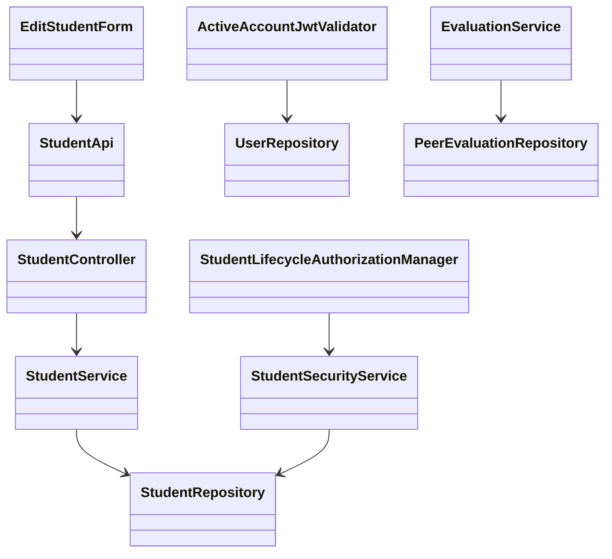
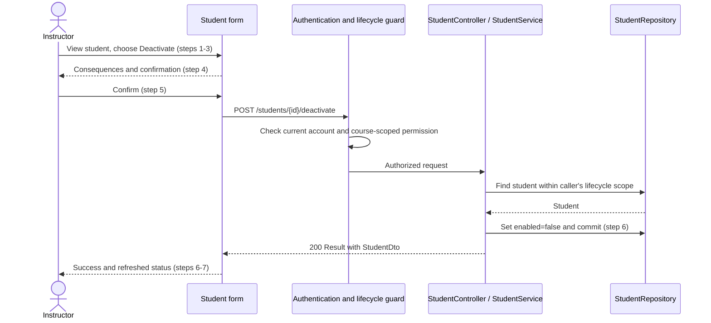

# Student Design

> Design shape accepted by the developer on 2026-11-13. Implementation starts only after the design pull request merges.

Repository: https://github.com/Fizzn0/add-a-use-case
Issue: https://github.com/Fizzn0/add-a-use-case/issues/1
Realizes: UC-STU-deactivate-student.
Depends on: FR-SEC-active-account, FR-SEC-authentication, FR-SEC-authorization.
Contracts: [UC-STU-deactivate-student](../requirements/use-cases.md#uc-stu-deactivate-student-the-course-admininstructor-deactivates-a-student), [business rules](../requirements/business-rules.md), and [security requirements](../requirements/software-requirements-specification.md#security-and-authorization-requirements).
Architecture: [Containers](architectural-design.md#containers) and [Crosscutting Concepts](architectural-design.md#crosscutting-concepts). Shared domain model: [SRS Business Domain Model](../requirements/software-requirements-specification.md#business-domain-model).

## Overview

This design extends the existing student lifecycle and evaluation services within the current Spring Boot/Vue application. It uses the accepted deactivation policies without adding a schema or a parallel authorization system.

## Components and data

Reuse StudentController, StudentService, StudentRepository, Student/StudentDto, UserRepository, UserUtils, EvaluationService, PeerEvaluationRepository, SubmissionStatusService, Result and the shared Axios instance.
Extend EditStudentForm.vue, apis/student and SubmitTeamsEvaluations.vue.
Add ActiveAccountJwtValidator and StudentLifecycleAuthorizationManager, plus a lifecycle-scoped repository lookup/security method. Add StudentUpdateRequest with an optional enabled field for the existing profile endpoint; StudentDto remains the response DTO. No schema change, new background job or reactivation use-case implementation.

| Component | Change | File |
|---|---|---|
| Student REST/service/query | Extend | [StudentController](../../backend/src/main/java/team/projectpulse/student/StudentController.java), [StudentService](../../backend/src/main/java/team/projectpulse/student/StudentService.java), [StudentRepository](../../backend/src/main/java/team/projectpulse/student/StudentRepository.java) |
| Scoped lifecycle authorization | New manager; extend security service | [authorization managers](../../backend/src/main/java/team/projectpulse/security/authorizationmanagers), [StudentSecurityService](../../backend/src/main/java/team/projectpulse/student/StudentSecurityService.java) |
| Current-account JWT validation | New validator wired to decoder | [SecurityConfiguration](../../backend/src/main/java/team/projectpulse/security/SecurityConfiguration.java), [UserRepository](../../backend/src/main/java/team/projectpulse/user/UserRepository.java) |
| Profile-update request | New StudentUpdateRequest | [student DTO package](../../backend/src/main/java/team/projectpulse/student/dto) |
| Evaluation eligibility/reports | Extend | [EvaluationService](../../backend/src/main/java/team/projectpulse/evaluation/EvaluationService.java), [PeerEvaluationRepository](../../backend/src/main/java/team/projectpulse/evaluation/PeerEvaluationRepository.java) |
| Reminder obligations | Reuse unchanged | [SubmissionStatusService](../../backend/src/main/java/team/projectpulse/notification/SubmissionStatusService.java) |
| Student action and client | Extend | [EditStudentForm](../../frontend/src/pages/students/EditStudentForm.vue), [student API](../../frontend/src/apis/student/index.ts) |
| New-evaluation targets | Extend | [SubmitTeamsEvaluations](../../frontend/src/pages/evaluations/SubmitTeamsEvaluations.vue) |



## Main sequence



```mermaid
sequenceDiagram
    participant Student
    participant JWT as ActiveAccountJwtValidator
    participant Users as UserRepository
    Student->>JWT: Next request with old signed token
    JWT->>Users: Read current account by signed userId
    Users-->>JWT: enabled=false
    JWT-->>Student: 401; shared client clears login state
```

## API contract

All routes use the configured /api/v1 base and existing Result envelopes.

| Operation | Caller/request | Success | Errors |
|---|---|---|---|
| POST /students/{studentId}/deactivate | Assigned instructor or owner of student's course; no body | 200 StudentDto, enabled=false; repeated call also succeeds, with already-deactivated message | 401 inactive/invalid caller; uniform 403 for unknown or unauthorized target at guard (E2/E4); 404 if scoped target disappears after guard; 5xx persistence failure (E5) |
| Existing JWT-protected requests | Existing signed token plus live account check | Existing response for active accounts | 401 inactive/deleted account, malformed identity, or inability to verify current account because the account lookup fails; use the existing authentication error envelope without internal database details; protected handling never executes; retain signature and expiry validation |
| Existing PUT /students/{studentId} | Existing profile fields | Existing profile response; cannot deactivate | Existing errors; no unauthorized lifecycle change |
| Existing POST /evaluations | Existing evaluation DTO | Existing response for eligible active target | Existing 400 validation response for inactive new evaluatee |
| Existing GET /evaluations/sections/{sectionId}/week/{week} | Existing course-section authorization | Active students retain current inclusion; inactive students require saved evaluations of them for that week | Existing errors |

## Decisions and alternatives

1. Preserve membership and records, per the accepted BR-student-deactivation-membership. Removing membership would change historical context. Include inactive students with saved evaluations of them for the requested week, even if later removed from their team; active students keep the current on-team condition. No historical-membership reconstruction is claimed.
2. Add a current-account validator during JWT decoding, alongside default timestamp validators. Query by stable signed userId, not mutable username. Cover inactive students and instructors because FR-SEC-active-account names both. Do not cache enabled state. This avoids a two-hour expiry delay or token-blocklist schema. A request authorized before deactivation commits is not retroactively cancelled; lookup failure must never allow access.
3. Use a lifecycle-specific guard, not the existing self-access guard. Require instructor authority and actual course ownership or course-section assignment; a global admin role alone grants no cross-course permission. Guard and service use caller-derived scope through UserUtils. The student detail-read path must admit the actual course owner as well as the assigned instructor, so a course owner not separately assigned can reach the action; retain student-self read access, never student-self lifecycle access. A repository query selects by target id plus course-admin id or assigned instructor id. Unknown/unauthorized target is a uniform route denial; service lookup also enforces scope.
4. Set only enabled=false in a transaction, never merge a browser-provided Student entity. Repeated calls are harmless. Concurrent requests that both observed active may both report success; the final state remains inactive. A failed persistence operation rolls back.
5. Replace the active student's status switch with a Deactivate button. Warning identifies the student and explains access, reminders, evaluations, retained membership/work and historical reports. It explicitly distinguishes deactivation from deletion: the account and submitted work are retained, not deleted. Cancel, Escape or close sends no request. Disable duplicate clicks while pending. Only an acknowledged success gets a success message; failures offer retry/refresh. Deactivation does not save unsaved profile edits.
6. Close the profile-update bypass by ignoring enabled=false on generic profile saves. Preserve the existing legacy reactivation path only for an authorized actor's explicit enabled=true request. Ordinary profile saves omit enabled, so a stale active form cannot reactivate a student disabled since it loaded. The existing inactive-account activation control sends true only when deliberately chosen. Use StudentUpdateRequest with nullable Boolean enabled: null and false preserve lifecycle state, true requests legacy activation. The existing PUT route retains its profile-access guard; whenever enabled=true is requested, the service additionally requires lifecycle authority and loads the target through the same caller-scoped lifecycle query used for deactivation. This service check applies even when called without an HTTP route and denies student-self or unrelated callers with 403 before any profile or lifecycle mutation. Preserve the existing profile field validation and ordinary profile ownership checks; do not add the reactivation use case or notifications.
7. Filter inactive students only while preparing NEW evaluation rows. Keep saved rows and their existing editing rules. The server rejects a new evaluation of an inactive student even from a stale form. Do not globally filter the team-members API, which other features use for historical context. Existing edits are governed by BR-evaluation-editable-until-close.
8. Reuse SubmissionStatusService unchanged: it already excludes inactive students and excludes them from peers' owed evaluations. Add a regression test rather than duplicate reminder policy.

## Required tests and oracles

| ID | Oracle / flow | Level | Assertions |
|---|---|---|---|
| T01 | Main steps 1-7 and warning Associated Information | Backend integration + Cypress | Before confirmation, warning names the selected student, loss of access/reminders/new evaluations, preserved membership/work, historical report rule and distinction from deletion; authorized confirmation persists false and displays success/refreshed status |
| T02 | BR-student-deactivation-membership | Unit + persistence integration | Team/course section/profile/activities/evaluations by and of student preserved; no-team case succeeds |
| T03 | E1 | Unit + integration | Repeated call succeeds without other mutations; already-deactivated response |
| T04 | E2; BR-section-scoped-access | Security + service integration | Lifecycle: assigned instructor and course owner succeed; unrelated instructor/admin, student self and anonymous denied; service cannot bypass scope. Detail-read regression: owning course admin not separately assigned, assigned instructor and student self succeed; unrelated instructor/admin/student denied |
| T05 | E3 | Cypress | Cancel, Escape and close issue zero deactivation requests |
| T06 | E4 | Security + service | Unknown id denied uniformly; scoped disappearance is not-found; other accounts unchanged |
| T07 | E5 | Rollback integration + Cypress | Failed write rolls back; timeout/5xx gives no success, releases pending state, allows retry; lost-response retry safe |
| T08 | FR-SEC-active-account | Real-token integration | Login before deactivation, reuse same JWT afterward: 401; fresh login denied; active account still works |
| T09 | FR-SEC-authentication; fail-closed account lookup | Validator + real-token integration | Expired/bad-signature/missing-id/malformed-id/deleted-account tokens denied; inactive instructor denied; repository lookup failure returns 401 without executing protected handling or exposing database details; do not rely solely on mocked jwt() |
| T10 | Dedicated-action bypass; BR-student-lifecycle | Service + HTTP integration + Cypress | Generic false cannot deactivate; stale profile cannot reactivate; explicit authorized legacy activation preserved; student-self and unrelated instructor/admin explicit activation denied without profile or lifecycle mutation, including direct-service invocation |
| T11 | BR-inactive-student-evaluations | Service + HTTP integration | New inactive-target evaluation refused without insert; active-target and existing-edit behavior unchanged |
| T12 | BR-inactive-student-evaluations | Report service + integration | Requested-week historical results included with scores; other-week/no results excluded; authored evaluations retained in peers' results; no-team historical result retained |
| T13 | BR-submission-owed | SubmissionStatusService regression | Inactive student owes neither item; peers owe only active teammates including self |
| T14 | Evaluation UI eligibility | Cypress | New form omits inactive target; saved rows retained; stale-target refusal prompts refresh without success |

Mutation experiment: temporarily remove the inactive-evaluatee refusal, run T11 and record the actual result, restore it, rerun. If it stays green, repair the test and explain why. No mutation evidence is claimed yet.

## Delivery and approval

The design PR references issue #1. Its description records specification validation and unresolved review limitations.
The user reviews and merges the design PR, as the assignment requires. Implementation follows the merged design in fresh context.
Build shared service/authentication changes first with tests; pause for the user's trunk review. Keep SecurityConfiguration changes in a separate commit, then controller/UI leaf commits. Run targeted checks per commit and full checks before opening the build PR.
The build PR links the design PR, says Closes #1, remains open for grading, and records real oracle mappings, mutation results, review findings and unverified items. Personal-review claims must match what the user actually reviewed.

## Validation status and risks

- No production code or application tests have run for this design-only change. The pull request records the specification checks and their exact coverage.
- Existing empty-extension gaps outside this use case remain in OI-40.
- One additional database read per JWT authentication; measure overhead during implementation.
- Verify current-account visibility after commit with a real token and real database.
- Verify Docker availability before MySQL integration tests. Report any unavailable checks rather than claiming success.
- No architectural boundary, deployment or schema change is proposed; this uses the existing authentication subsystem and domain boundaries. When implementation lands, qualify the architecture-of-record's Authentication statement that tokens remain valid for two hours: two hours is the cryptographic expiry, while current-account eligibility is checked on every authenticated request. This is planned synchronization of the existing authentication documentation, not a new authentication subsystem; do not claim the live-account check is already built in this design-only PR.
