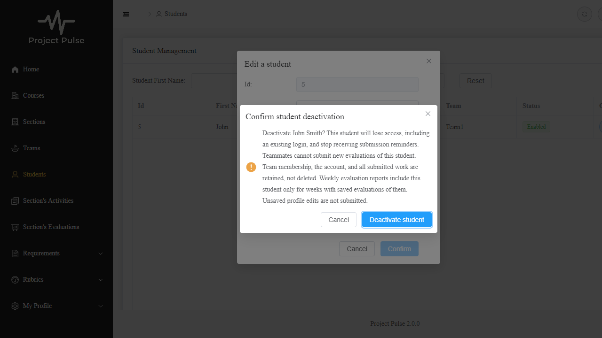

# Student deactivation build evidence

UC-STU-deactivate-student; [design](../design/stu.md); [issue #1](https://github.com/Fizzn0/add-a-use-case/issues/1); [merged design #2](https://github.com/Fizzn0/add-a-use-case/pull/2). Verification results recorded 2026-11-13.

## Commands and actual outcomes

- Backend full `mvnw.cmd test`: attempted; 176 tests reported, 26 container/context initialization errors, no assertion failures. Docker was not available. This is a failed full-suite run, not a passing integration result.
- Backend `mvnw.cmd -DexcludedGroups=integration "-Dtest=*,!WebConfigSpaForwardingTest" test`: 151 passed, zero failures/errors. The excluded SPA test also uses containers. After adding the scope-lookup failure case, `mvnw.cmd -Dtest=StudentLifecycleAuthorizationTest test`: all 4 passed. New integration sources compile, but have not executed.
- Frontend `cypress run --config baseUrl=http://127.0.0.1:5175 --spec cypress/e2e/student-deactivation.spec.cy.js`: 11 passed. This exercises the actual Vue UI with stubbed HTTP, not a running MySQL/backend stack. The other existing Cypress specs require that unavailable stack and were not run.
- Frontend `npm run build`: Vite production bundle succeeded; the combined command failed type checking. Both this branch and an isolated `main` frontend copy report the same 18 TypeScript diagnostic lines, with no additional diagnostics. Existing Sass/chunk-size warnings remain.
- `git diff main --check`: passed. The repository documentation audit reports no new findings against merged main; its mechanical ID/link/trace checks do not constitute every manual `/spec-build` check.

## Required test-list coverage

| Design row | Evidence | Remaining limit |
|---|---|---|
| T01 | Cypress warning/one confirmed request/refreshed disabled status | Real HTTP/database integration authored, not executed |
| T02 | Service preserves profile/team/section; no-team case | Actual work records/counts and overlapping writes require MySQL |
| T03 | Unit repeat performs one save; integration repeat response authored | Database repeat/lost-response end-to-end unverified |
| T04 | Scoped-role helper and service refusal tests | Actual JPQL scope, route matrix and owner-not-assigned integration unverified |
| T05 | Cypress Cancel, Escape and close: zero lifecycle/profile writes; unsaved fields preserved | Covered at UI level |
| T06 | Unit missing/out-of-scope lookup and no writes | Uniform HTTP denial authored but unexecuted |
| T07 | Cypress 500 and network failure: no success, pending released, retry works; persistence rollback test authored | Real controller/service failed-commit boundary, actual timeout and committed-but-lost response not end-to-end verified |
| T08 | Real signed JWT accepted, then same token rejected after mocked current account changes | Real committed account change and new-login denial integration unexecuted |
| T09 | Real signature/expiry; validator missing/malformed/deleted/disabled-instructor and database failure | Fail-closed HTTP 401/no-handler execution on DB outage unverified |
| T10 | Generic false/null/true service behavior; self/unrelated activation refused; stale admin and self-profile Cypress payloads | HTTP activation matrix and overlapping MySQL transactions unexecuted |
| T11 | New inactive target rejects with no insert; active target accepts | Actual HTTP/SQL insertion unverified |
| T12 | Recorded-week historical inactive/no-team result and existing edit window unit tests | Real database history and authored evaluations retained in peers' results not integration-verified |
| T13 | Existing SubmissionStatusServiceTest: inactive excluded and peers owe active teammates including self | Scheduler/email delivery not exercised by this change |
| T14 | Cypress inactive-new exclusion, saved-row retention, refusal/refresh and partial-write recovery | API responses stubbed |

Build is **Built**, verification **Partial**. Every extension has some authored coverage; E5 rollback and several real persistence/authentication aspects have not passed an executable integration test here.

## Tests retained and oracle sources

Each line names a relevant new/changed test, or an existing regression relied upon. Values come from the approved use case/business rules/design rows, rather than the implementation's current return values.

### StudentDeactivationServiceTest

- `deactivationPreservesMembershipAndProfile` — T02; BR-student-deactivation-membership, only enabled changes.
- `repeatedDeactivationAndNoTeamAreHarmless` — T02/T03; E1 harmless repeat and optional team.
- `studentSelfCannotDeactivateOrExplicitlyActivate` — T04/T10; BR-student-lifecycle.
- `unrelatedInstructorCannotMutateThroughService` — T04/T06/T10; E2/E4 and caller-derived scope.
- `profileUpdateCannotDisableAndStaleSaveCannotReactivate` — T10; dedicated-action bypass policy, nullable flag and authorized legacy activation.
- `studentSelfCanSaveOrdinaryProfileWithoutLifecycleFlag` — T10; ordinary self-profile access preserved.

### StudentLifecycleAuthorizationTest

- `rejectsStudentSelfAndAnonymousWithoutQuery` — T04; E2 role requirement.
- `adminRoleRequiresActualCourseScope` — T04; BR-section-scoped-access, admin is not globally privileged.
- `assignedInstructorRequiresScopedTarget` — T04/T06; assignment scope and unresolved target denial.
- `unavailableScopeLookupDeniesAccess` — T04; architecture security helpers deny unresolvable scope.

### ActiveAccountJwtValidatorTest

- `rechecksCurrentAccountOnEveryValidation` — T08; FR-SEC-active-account, no enabled-state cache.
- `rejectsMalformedIdentity` (six values) — T09; signed identity must resolve to a valid stable account id.
- `rejectsMissingIdentityAndDeletedAccount` — T09; credentials alone do not establish a current account.
- `databaseFailureDeniesWithoutExposingDetails` — T09; fail-closed lookup with generic error.

### ActiveAccountSignedTokenTest

- `sameSignedTokenFailsAfterAccountIsDisabled` — T08; existing login loses access on next validation.
- `defaultExpiryValidationIsPreserved` — T09; FR-SEC-authentication, timestamp checks retained.
- `badSignatureIsRejectedBeforeAccountLookup` — T09; signature validation cannot be replaced by account lookup.
- `disabledInstructorAndDeletedUserAreAlsoDenied` — T09; FR-SEC-active-account covers both roles.

### InactiveStudentEvaluationTest

- `rejectsNewEvaluationOfInactiveTeammate` — T11; BR-inactive-student-evaluations. Mutation-tested below.
- `acceptsActiveTarget` — T11; active-target behavior retained.
- `inactiveHistoryIsIncludedOnlyInItsRecordedWeekEvenWithoutTeam` — T12; saved evaluations OF the student determine historical inclusion.
- `savedEvaluationOfInactiveStudentStillUsesExistingEditWindow` — T12; BR-evaluation-editable-until-close.

### StudentDeactivationIntegrationTest (compiled, not executed)

- `confirmedAndRepeatedActionPreservesDataAndMembership` — T01/T02/T03; false persisted, membership and record counts retained, E1 response.
- `ownerNotAssignedToSectionCanReadAndDeactivate` — T04; actual course ownership grants access without separate assignment.
- `unauthorizedAndMissingTargetsAreRefused` — T04/T06; anonymous/self/unrelated/missing HTTP refusals.
- `selfProfileCannotActivateOrDeactivate` — T10; false preserves, explicit self-activation forbidden.
- `committedDeactivationRejectsTheSameTokenAndNewLogin` — T08; real commit followed by existing-token/new-login rejection.
- `overlappingProfileAndLifecycleWritesPreserveEachOthersFields` — T02/T10; separate persistence contexts and reversed commit orders preserve disjoint fields.
- `persistenceFailureRollsBackAlreadyFlushedDeactivation` — T07/E5; a validation failure rolls back an already flushed enabled change. This directly tests persistence, not the controller's transaction boundary.

### student-deactivation.spec.cy.js (HTTP stubbed)

- `T01 warns before sending, then refreshes disabled status exactly once` — main flow/warning Associated Information; includes duplicate-click suppression and no profile write.
- `T05 Cancel sends nothing and preserves form edits` — E3.
- `T05 Escape sends nothing and preserves form edits` — E3.
- `T05 close sends nothing and preserves form edits` — E3.
- `T07 server failure offers safe retry without success` — E5, unsuccessful response cannot produce success UI.
- `T07 network failure offers safe retry without success` — E5, unacknowledged response cannot produce success UI.
- `T10 stale active profile never sends an activation flag` — dedicated-action bypass and stale-form policy.
- `T10 ordinary student self-profile save omits lifecycle state` — self-profile compatibility from T10.
- `T14 omits inactive new targets but retains saved inactive rows` — BR-inactive-student-evaluations and existing edit policy.
- `T14 stale-target refusal prompts refresh with no success or receipt` — T11/T14 server remains authoritative after page load.
- `T14 waits for partial writes before refresh and updates saved rows on retry` — T14 recovery, preserved saved work and no duplicate insertion.

### Existing regression tests

- `StudentServiceTest.testStudentUpdateOwnInfo` — T10; false cannot deactivate self; adapted to new request DTO.
- `StudentServiceTest.testInstructorUpdatesStudent` — T10; profile false must now preserve active state, rather than bypass the dedicated warning; adjusted expected value is spec-driven.
- `SubmissionStatusServiceTest.testWeeklyActivityReportOwedByEligibleStudentsWithNoActivity` — T13; BR-submission-owed excludes inactive/no-team students.
- `testPeerEvaluationOwedUntilEveryActiveTeammateIncludingSelfIsEvaluated` — T13; inactive teammates are not owed targets.
- `testEvaluatingSomeoneOutsideTheTeamDoesNotCount` — T13; only current eligible peers satisfy the obligation.
- `testFindOwedItemsListsOnlyTheItemsEachStudentOwes` — T13; independent owed-item rules.
- `testNobodyOwesWhenEveryoneSubmitted` — T13; no reminder obligation after completion.

No existing test was deleted. Mockito fixtures were corrected to stub the new scoped finder and requested report week. The network-failure Cypress fixture was changed to fail all automatic transport retries until the explicit retry phase; a one-response failure had allowed the browser's automatic retry to succeed. The error-banner assertion scrolls into view after clicking a lower-page button. These fixes preserved the requirement's oracle.

## Actual mutation experiment

Least-trusted test: `InactiveStudentEvaluationTest.rejectsNewEvaluationOfInactiveTeammate`, because other validation (week/team/duplicate checks) could accidentally make it pass. Its fixture uses an eligible current week, same-team students and no duplicate.

Changed only `if (!newPeerEvaluation.getEvaluatee().isEnabled())` to `if (false)` in EvaluationService. Ran `mvnw.cmd -Dtest=InactiveStudentEvaluationTest#rejectsNewEvaluationOfInactiveTeammate test`: **1 test, 1 failure, 0 errors**, with `Expecting code to raise a throwable.` This establishes that the chosen test detects removal of that guard. Restored the original line in a finally block; `InactiveStudentEvaluationTest,StudentDeactivationServiceTest`: **10 passed**. No mutation is committed.

## Independent review and human-review handoff

- P1: ordinary self-profile sent enabled=true and was denied. Fixed in `a6a4a69`; explicit profile-only payload plus service/Cypress regressions.
- P1: whole-row ORM saves could restore stale enabled/profile state. Fixed in `a6a4a69` with Student dynamic updates; two-context persistence regression authored. Generated SQL/concurrency still needs MySQL execution.
- Follow-up review confirmed both code fixes, while retaining the persistence verification limitation. Evaluation early-rejection race fixed in `5d9d609` using allSettled; the delayed-success/refusal Cypress case passed.
- No independent review finding was rejected. Broader performance measurement for per-request account lookup remains unperformed.
- Implementation continued in the same chat without the fresh-session/trunk-review pauses.

Before submitting: inspect the trunk (`bc44712`), security (`891c670`), leaves and fixes, and review the T01–T14 table. The [labeled diff comment](https://github.com/Fizzn0/add-a-use-case/pull/3#discussion_r4567117954) records the outstanding MySQL concurrency check. Keep the build PR open and submit its URL to TCU Online.
